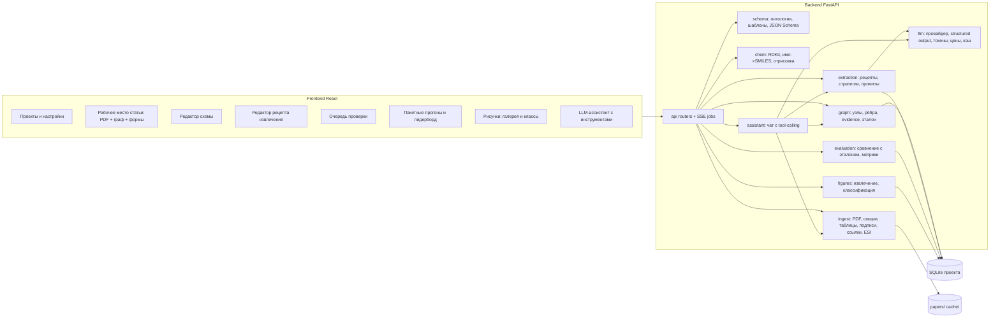
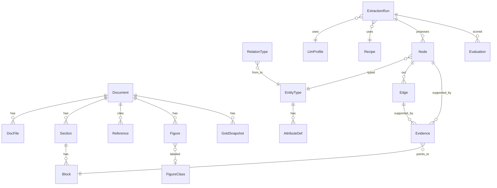
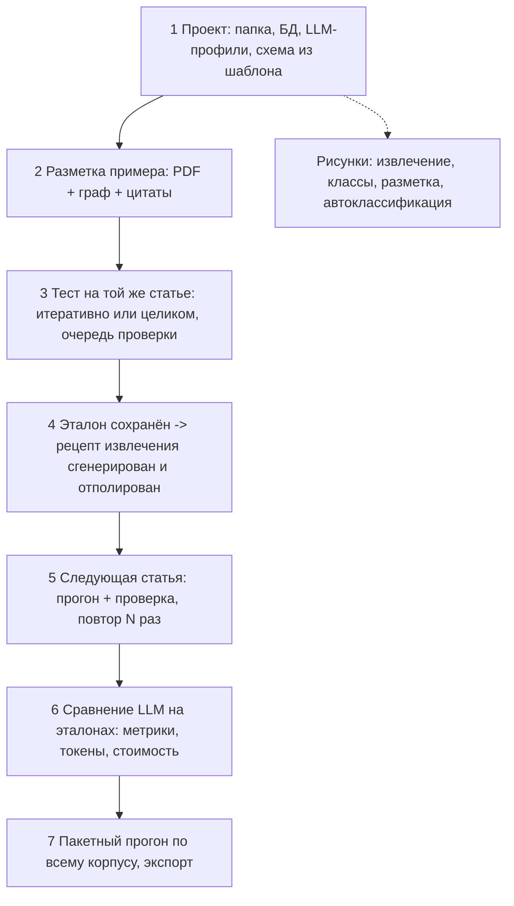

# Архитектура Paper2Data

Локальное веб-приложение для человеко-управляемого извлечения графа сущностей (соединения, состав, свойства, условия, устройства) из научных статей с помощью LLM. Пользователь размечает эталон на 1–N статьях; программа превращает разметку в схему, промпты и рецепт извлечения, затем прогоняет любые LLM по корпусу с оценкой качества и стоимости.

## 1. Ключевые решения

- **Поставка**: локальное веб-приложение. `start.bat` / `python run.py` поднимает FastAPI и открывает браузер. Внешних сервисов (Redis, Neo4j) нет — только Python + SQLite.
- **Проект = папка**: `project.yaml` (настройки, LLM-профили, активная схема), `papers/` (PDF статей и ESI), `paper2data.sqlite`, `cache/` (разобранный текст, картинки, ответы LLM), `exports/`.
- **Схема (онтология) — данные, а не код.** Пользователь в UI описывает типы сущностей, атрибуты и связи. Из схемы порождаются: формы UI, узлы графа, JSON Schema для structured output LLM, промпты, валидация, экспорт. Поставляются шаблоны в `templates/` (координационные соединения, OLED). Непрограммист берёт шаблон и правит, а не строит с нуля.
- **Свойство — узел, а не атрибут.** У свойства есть условия измерения, цитата; оно может ссылаться на другое соединение (например, триплетный уровень Eu-комплекса, измеренный на Gd-аналоге). Простые поля (SMILES, IUPAC, шифр) — атрибуты узла; каждый атрибут тоже имеет evidence.
- **Каждое значение подкреплено цитатой** (`Evidence`: блок текста / ячейка таблицы / подпись рисунка + позиция на странице). LLM обязана вернуть quote; бэкенд проверяет её fuzzy-поиском (rapidfuzz) в тексте статьи, иначе элемент помечается «не подтверждено».
- **LLM**: единый OpenAI-совместимый клиент (`openai` SDK с `base_url`) — OpenAI, OpenRouter, DeepSeek, vLLM, LM Studio, Ollama (`/v1`). Профиль модели: url, ключ (в `~/.paper2data/secrets`), цены in/out за 1M токенов, размер контекста, «уровень интеллекта» (стратегия по умолчанию), поддержка JSON-режима.
- **Стек**: Python 3.11, FastAPI, SQLAlchemy + Alembic, Pydantic v2, NetworkX, PyMuPDF, pdfplumber, rapidfuzz, tiktoken, RDKit, Jinja2. Фронт: Vite + React + TypeScript, React Flow, pdf.js/react-pdf, TanStack Query, shadcn/ui, SSE для прогресса задач.

## 2. Компоненты



### Backend (модули)

| Модуль | Назначение |
|--------|------------|
| `api` | HTTP-роутеры, SSE прогресса задач |
| `core` | конфиг, пути проекта, утилиты |
| `db` | SQLAlchemy, Alembic, модели |
| `ingest` | PDF → секции, блоки, таблицы, подписи, ссылки, ESI |
| `schema` | загрузка YAML-шаблонов, версионирование онтологии, JSON Schema |
| `graph` | узлы, рёбра, evidence, эталон (`GoldSnapshot`) |
| `llm` | провайдер, structured output, токены, цены, кэш |
| `extraction` | рецепты, стратегии, генерация промптов |
| `evaluation` | сравнение с эталоном, метрики |
| `chem` | RDKit, OPSIN/PubChem, отрисовка структур |
| `figures` | извлечение изображений, классификация CLIP+kNN |
| `assistant` | чат с tool-calling над графом |

### Frontend (экраны)

- Проекты и настройки (папка, LLM-профили, шаблон схемы)
- Рабочее место статьи: PDF с подсветкой + граф (React Flow) + формы
- Редактор схемы и рецепта извлечения
- Очередь проверки предложений LLM
- Пакетные прогоны и лидерборд моделей
- Галерея рисунков и классы
- LLM-ассистент с инструментами

### Структура репозитория

```
backend/paper2data/{api,core,db,ingest,schema,graph,llm,extraction,evaluation,chem,figures,assistant}
backend/tests/
frontend/src/{pages,components,api,store}
templates/*.yaml              # шаблоны схем
templates/recipes/*.yaml      # примеры рецептов извлечения
docs/ARCHITECTURE.md
run.py, start.bat
```

## 3. Модель данных (SQLite)



### Основные сущности

- **Document / DocFile** — статья; роль файла (`main`, `esi`); DOI; метаданные (Crossref).
- **Section** — тип (`abstract`, `introduction`, `experimental`, `results`, `conclusion`, `acknowledgments`, `references`, `esi`, `other`); диапазон страниц; «полезность» по умолчанию (intro/acknowledgments выключены из извлечения).
- **Block** — параграф / ячейка таблицы / таблица целиком / подпись рисунка; текст, страница, bbox — основа для evidence и подсветки в PDF.
- **Reference** — библиография с DOI (regex + Crossref); связь «упомянуто в литературе».
- **EntityType / AttributeDef / RelationType** — схема. Атрибут: имя, тип (`text`, `number`, `number_with_unit`, `range`, `enum`, `smiles`, `inchi`, `doi`, `bool`), единица, обязательность, подсказка для LLM. Связь: from/to типы, кардинальность, атрибуты (роль лиганда, стехиометрия), подсказка. Схема версионируется.
- **Node / Edge** — экземпляры; `attributes` JSON; `status` (`manual`, `proposed`, `accepted`, `rejected`); `document_id`, `run_id`; `canonical_id` для слияния дублей между статьями.
- **Evidence** — node/edge/attribute → block, char-span, quote, страница, bbox, автор (человек/LLM), `verified` (найдена ли цитата в тексте).
- **GoldSnapshot** — замороженная копия принятого графа статьи — эталон для few-shot и метрик.
- **Recipe** — декларативный рецепт извлечения (YAML): шаги, стратегия, области текста, цели, промпт-шаблоны; версионируется.
- **LlmProfile, ExtractionRun, Evaluation** — параметры модели, токены/стоимость/время (факт и оценка), метрики vs эталон.
- **Figure / FigureClass** — картинка, страница, подпись, класс, уверенность, ручная метка.

## 4. Шаблоны схем

Шаблоны лежат в `templates/` и загружаются модулем `schema`. Формат YAML: `version`, `id`, `name`, `entity_types`, `relation_types`, опционально `extraction_groups` и `attribute_extensions`. Схемы могут **импортировать** друг друга (`imports:`); группы извлечения при импорте **склеиваются** по `id` (entities/relations дополняются).

### Ядро (`templates/compounds_core.yaml`)

Общая база без доменных enum: `Paper`, `CompoundFamily`, `Compound`, `Component`, `Property` (`other`), `Condition` (state, solvent, T, notes) и связи `HAS_FAMILY` / `HAS_MEMBER` / `HAS_COMPONENT` / `HAS_PROPERTY` / `MEASURED_UNDER` / `MEASURED_ON` / `SAME_AS` / `SYNTHESIZED_LIKE` / `REPORTED_IN`. Группа `compounds`.

### Координационные соединения (`templates/coordination_compounds.yaml`)

Импортирует `compounds_core`, добавляет роли лигандов и люминесцентный enum свойств:

- `Compound` → `HAS_COMPONENT{role, count}` → `Component`. Роли: `central_cation` | `anionic_ligand` | `neutral_ligand`.
- `Compound` → `HAS_PROPERTY` → `Property` (lifetime, quantum_yield, emission_wavelength, …) → `MEASURED_UNDER` → `Condition` (state, solvent, T, λ_ex, λ_em, концентрация).
- `Property` → `MEASURED_ON` → другой `Compound` (например Gd-аналог).
- Группы: `compounds`, `luminescence`.

### Люминесценция (`templates/luminescence.yaml`)

Overlay поверх coordination: `fwhm`, `stokes_shift`, `cie_coordinates`, `sensitization_efficiency` + те же группы с уточнёнными инструкциями.

### OLED (`templates/oled.yaml`)

Импортирует coordination и расширяет:

- `Device` → `HAS_CHARACTERISTIC` → `Property` (eqe, luminance, …).
- `Device` → `HAS_LAYER{order}` → `Layer` → `MADE_OF` → `Material` → `IS_COMPOUND` → `Compound`.
- Группы: `compounds`, `luminescence`, `device_stack`, `device_metrics`.

### Токсичность (`templates/toxicity.yaml`)

Импортирует `compounds_core`; endpoints в `Property` (`ic50`, `ec50`, `lc50`, `ld50`, `mic`, `cc50`, `selectivity_index`); Condition с organism / cell_line / assay_name / exposure_time / route. Группы: `compounds`, `toxicity`.

### `extraction_groups`

Декларативные подграфы для генератора рецепта и bundled YAML:

```yaml
extraction_groups:
  - id: device_stack
    name: OLED-стек
    entities: [Device, Layer, Material]
    relations: [HAS_LAYER, MADE_OF, IS_COMPOUND]
    section_include: [experimental, results]
    instructions: >
      Разбери стек Device → Layer → Material → IS_COMPOUND…
```

Генератор (`generate_recipe_from_schema_and_gold`) создаёт **отдельный шаг на группу**, а не один шаг со всеми типами. Типы вне групп попадают в `extract_ungrouped`. Без `extraction_groups` поведение прежнее (один шаг).

Bundled-рецепты: `templates/recipes/oled_extract.yaml`, `luminescence_extract.yaml`, `toxicity_extract.yaml`.

## 5. Пользовательский поток



1. **Проект** — выбор папки, создание/открытие `paper2data.sqlite`, миграции, индексация `papers/`. Настройки: LLM-профили («проверить подключение»), шаблон схемы, статус статей (`parsed` → `annotated` → `gold` → `extracted`).
2. **Разметка** — PDF слева с подсветкой; справа Граф / Таблица / Карточка. Выделение → «Создать сущность», «Значение атрибута», «Цитата». Связи — рёбрами или формой. Ассистент понимает команды и создаёт узлы через tool-calling.
3. **Тест на примере** — стратегии `iterative` / `entities_first` / `one_shot` (см. §6). Результат → очередь проверки (принять / изменить / отклонить; слияние дублей).
4. **Эталон и рецепт** — «Сохранить как эталон» → `GoldSnapshot`. Генератор рецепта: схема + эталон → YAML шагов, Jinja2-промпты, JSON Schema, few-shot. Редактор: drag-and-drop шагов, предпросмотр промпта, прогон шага с diff.
5. **Следующие статьи** — те же экраны; новые эталоны обогащают few-shot.
6. **Сравнение LLM** — эталонные статьи × профили × стратегия → precision/recall/F1, точность атрибутов, связи, доля verified-цитат, токены и стоимость → лидерборд.
7. **Пакет** — оценка токенов × цены; фоновая очередь jobs + SSE; кэш по хэшу промпта. Экспорт: CSV/XLSX, JSON графа, GraphML, SDF.
8. **Рисунки** — галерея, классы, CLIP+kNN (или stub-эмбеддинг), корзина «Не уверен».
   Детекция DocLayout/YOLO **не используется**: области берутся из встроенных изображений PDF и рендера над подписями (`Fig.`/`Scheme`/`Table`). См. `paper2data/figures/extract.py` и README.

## 6. Стратегии извлечения

| Стратегия | Поведение |
|-----------|-----------|
| `iterative` | «Найти следующую сущность» → связи/свойства этой сущности → человек принимает → повтор. Удобно для проверки. |
| `entities_first` | Все сущности → проверка → все связи → проверка. |
| `one_shot` | Весь граф секции за 1–2 прохода (для сильных моделей). |

Стратегия задаётся **на шаг**. Для доменных схем шаг должен быть **узким** (`targets.entities` / `relations` из `extraction_groups`), а не «все типы схемы сразу»: иначе модель дедуплит уже принятые узлы и пропускает промежуточные (например Layer/Material между Device и Compound).

### Детали качества

- Чанкование по секциям с учётом лимита контекста; таблицы — Markdown с id ячеек; подписи рисунков — отдельным списком. Ссылки исключены из чанков, но доступны для резолва `[12]` → DOI.
- Structured output: JSON Schema из схемы проекта (фильтр по `targets` шага); при невалидном JSON — один repair-запрос; Pydantic-валидация типов/единиц (pint, например см⁻¹ ↔ нм).
- Каждый предложенный элемент несёт `quote` + `block_hint`; fuzzy ≥ 90 → `verified`.
- Разрешение шифров: шаг «словарь обозначений» (`1` = `Eu(DBM)3BPhen`) выполняется первым и подмешивается в последующие промпты.
- Доменные хинты — в `step.instructions` / группе схемы, не в коде генератора.

Пример рецепта: `templates/recipes/example_coordination_extract.yaml`. OLED-стек: `templates/recipes/oled_extract.yaml`.

## 7. Этапы реализации (milestones)

| Этап | Содержание |
|------|------------|
| **M0 Каркас** | Репозиторий, FastAPI + SQLite + Alembic, React-скелет, открытие/создание проекта, LLM-профили с тестом подключения, `run.py`. |
| **M1 Ingest + просмотр** | Разбор PDF, секции, блоки, таблицы, подписи, ссылки/DOI, ESI-детекция; PDF-вьюер с подсветкой. |
| **M2 Схема + ручная разметка** | Редактор схемы, шаблоны YAML, граф-редактор, evidence из выделения, эталон, экспорт CSV/JSON. |
| **M3 LLM-извлечение** | Движок рецептов, стратегии, генерация промптов из схемы+эталона, очередь проверки, проверка цитат. |
| **M4 Корпус и сравнение** | Метрики vs эталон, оценка токенов/стоимости, пакетные прогоны, лидерборд, слияние дублей, полный экспорт. |
| **M5 Рисунки** | Извлечение, галерея, классы, разметка, CLIP+kNN, корзина «Не уверен». |
| **M6 Обогащение и ассистент** | RDKit/OPSIN/PubChem, Crossref, чат-ассистент с инструментами. |
| **Будущее** | Извлечение данных из рисунков; поиск недостающих свойств по другим статьям через `canonical_id`. |

## 8. Контракт шаблонов

Файлы в `templates/` и `templates/recipes/` фиксируют контракт между модулями `schema`, `graph` и `extraction` до написания кода:

- **Схема** (`kind: schema`): `version`, `id`, `name`, опционально `imports`, `entity_types[]`, `relation_types[]`.
- **Рецепт** (`kind: recipe`): `version`, `id`, `name`, `schema_id`, `steps[]` со стратегиями, фильтрами секций и плейсхолдерами промптов.
